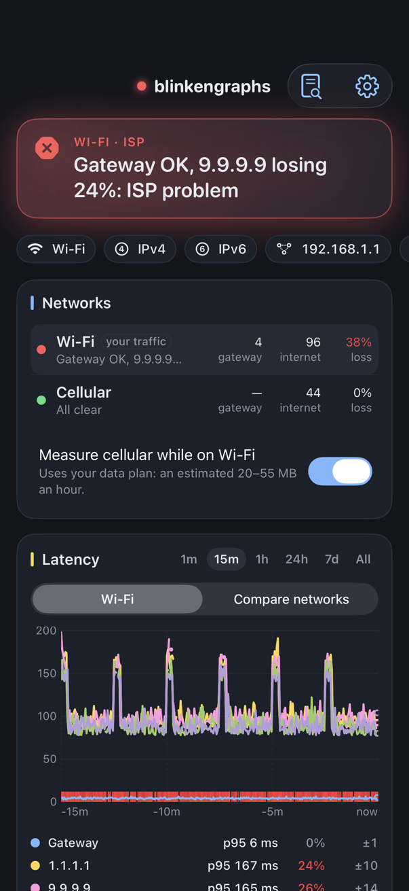
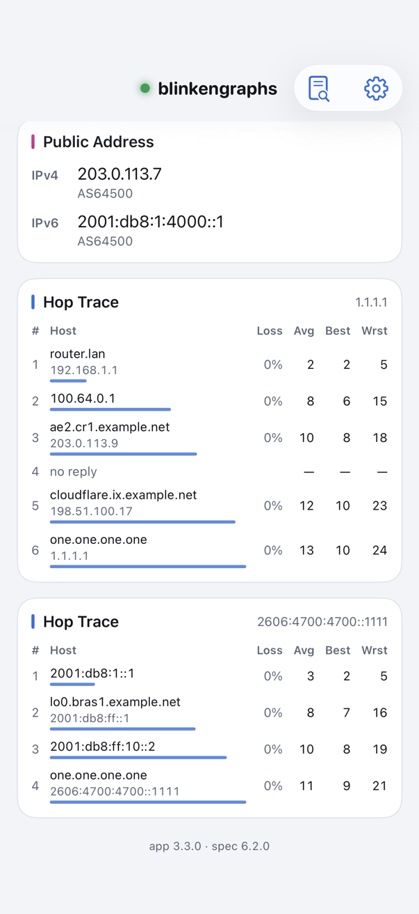
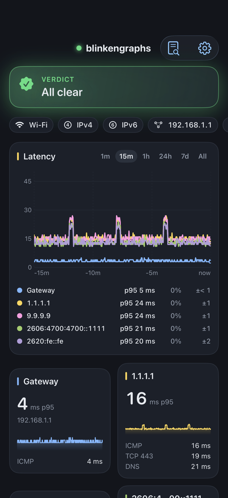
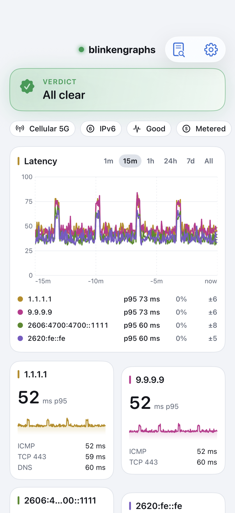
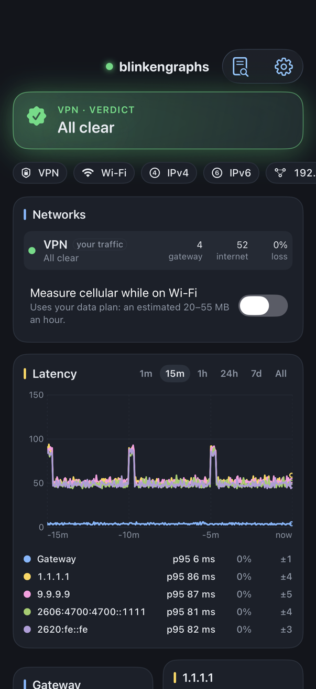
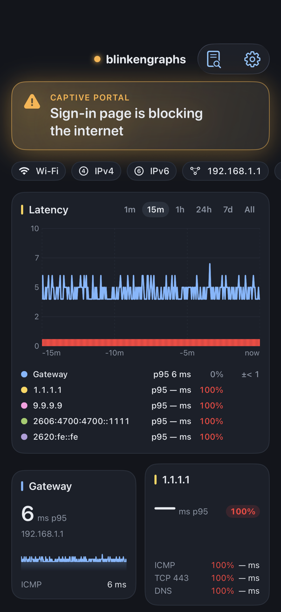
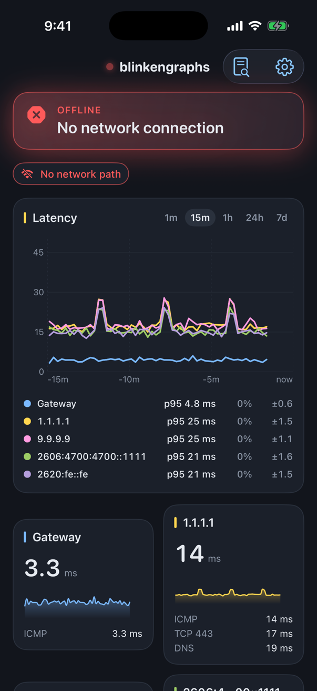
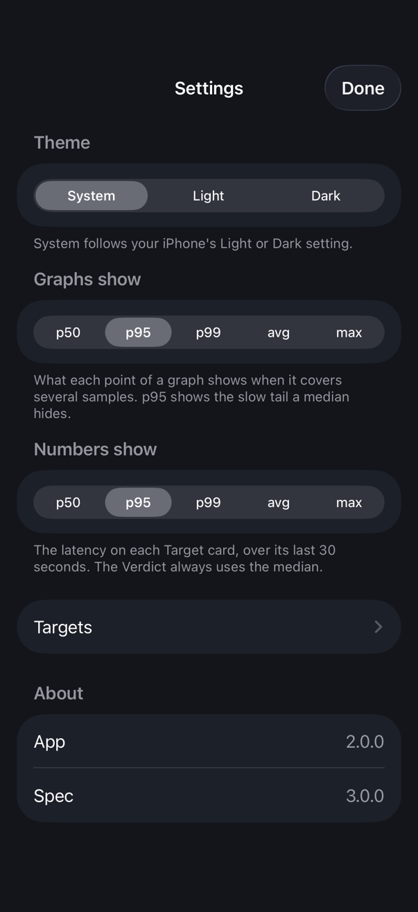
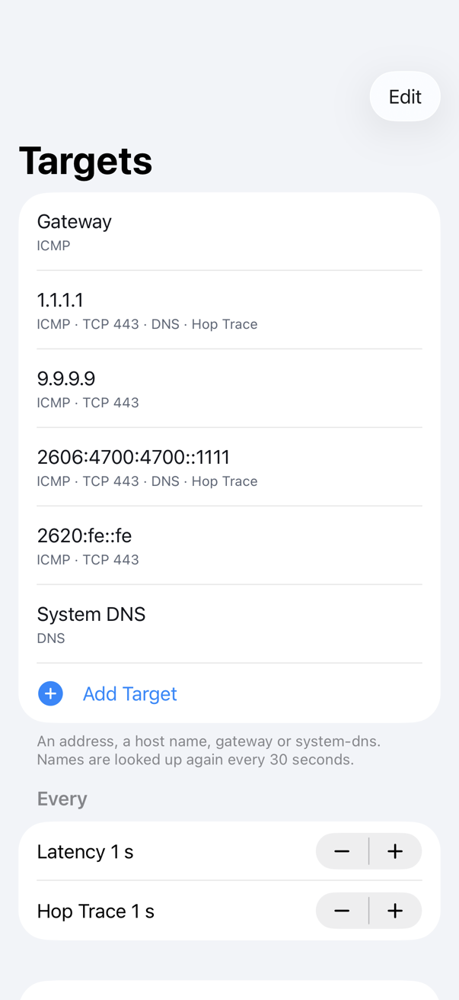
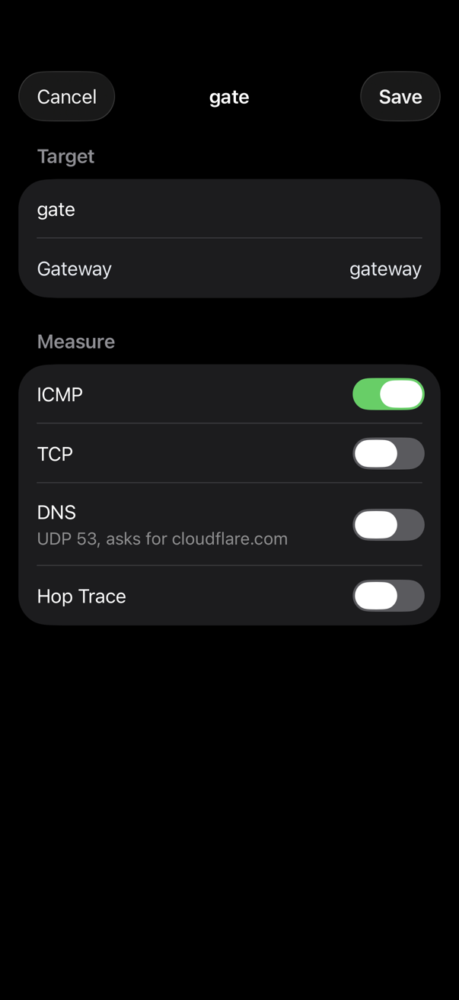

# blinkengraphs for iOS

A network diagnosis tool for iPhone and iPad. It shows live latency, DNS, path state and a hop trace, and gives a plain-language Verdict on where the network is failing: your Wi-Fi, your ISP, DNS, a VPN, a sign-in page or the far end.

<p>
  
  
  
</p>

**Status:** released, not on the App Store yet ([ADR 0003](docs/adr/0003-sideload-first.md)). Needs iOS 18 or later. Each [release](https://github.com/reconbot/blinkengraphs-ios/releases/latest), and the rolling [`main-latest`](https://github.com/reconbot/blinkengraphs-ios/releases/tag/main-latest) prerelease, carries an unsigned IPA to sideload with AltStore or Sideloadly, which sign it with your Apple ID. Or build from source below. It is the iOS member of the [blinkengraphs](https://github.com/reconbot/blinkengraphs) family; the [Windows version](https://github.com/reconbot/blinkengraphs-win) also ships.

## What it shows

- **Verdict:** names the fault, following the spec's rules: LAN or Wi-Fi, ISP, IPv4 or IPv6 broken, DNS, a remote host, ping filtering, a VPN or its exit, a captive portal, or no network at all.
- **Networks:** every network the phone is on, each judged on its own: the one carrying your traffic first, then Wi-Fi or cellular beside it. Tap one to chart it ([ADR 0017](docs/adr/0017-every-active-link-measured.md)).
- **Latency:** a gping-style chart with one line per Target (Gateway, Cloudflare, Quad9, over IPv4 and IPv6) and a loss strip, or Compare networks: one Target on every network. Ranges are 1m, 15m, 1h, 24h, 7d and All, and each point shows p95 by default. Time the app was closed is shaded as Paused.
- **Targets:** ICMP, TCP 443 and DNS per Target, including your own DNS server, with sparklines.
- **Hop Trace:** mtr-style, with router names and the silent tail collapsed.
- **Public Address:** your IPv4 and IPv6 as the internet sees them, from a DNS and an HTTPS lookup, flagged when the two disagree.
- **Reports:** copy or share a plain-text report, optionally redacted, for bug reports.
- **Light and dark**, following the system or chosen in Settings.

## Settings

- **Targets:** add, edit, reorder or delete them. A Target is an address, a host name, or a preset the editor offers as you type: Gateway (`gateway`) or System DNS (`system-dns`). Each measures any of ICMP, a TCP port, DNS (UDP 53) and Hop Trace, and the Latency and Hop Trace intervals are set here too ([ADR 0010](docs/adr/0010-editable-targets.md)). Reset returns to the spec's defaults.
- **Graphs show** and **Numbers show:** p50, p95, p99, average or maximum, for the graph lines and the readout on each Target card. The Verdict always uses the median.
- **Measure cellular while on Wi-Fi:** off by default, since it spends your data plan (an estimated 20–55 MB an hour while the app is open).
- **Theme:** System, Light or Dark.

| | | |
|---|---|---|
| <br>All clear | <br>5G, IPv6-only | <br>Through a VPN |
| <br>Captive portal | <br>Offline | <br>7 days |
| <br>Settings | <br>Targets | <br>New Target, with presets |

Screenshots are rendered by CI from demo data on every change to `main`.

## Scope

- Measures only while the app is open: no widget, no Live Activity ([ADR 0004](docs/adr/0004-foreground-only.md)).
- History is kept per network: every result for 2 hours, then 5-minute, hourly and daily summaries for 24 hours, 7 days and a year. Time the app was closed shows as Paused ([ADR 0015](docs/adr/0015-history-follows-spec-5.md), [ADR 0016](docs/adr/0016-history-on-disk.md)).
- No system-wide CPU or memory: iOS doesn't expose them to apps.
- After launch or a return to the app, measurements resume after a 2 s settle, and the Verdict reads "Resuming measurements" until they do. After a network change, Probes wait for the route to hold for 1 s, so a Wi-Fi to cellular switch isn't recorded as loss ([ADR 0013](docs/adr/0013-probes-wait-for-the-path-to-settle.md), [ADR 0015](docs/adr/0015-history-follows-spec-5.md)).
- iOS Local Network Privacy asks before the app sends TCP or DNS to the Gateway; if you decline, those Probes show as `denied`, never as loss. ICMP isn't gated, and you can change the choice in Settings > Privacy & Security > Local Network ([research](docs/research/local-network-privacy.md)).

## Network traffic

Besides your Targets, the app contacts only these hosts, all from the spec's [`defaults.json`](https://github.com/reconbot/blinkengraphs/blob/main/defaults.json):

| Host | Why |
|---|---|
| `cp.cloudflare.com` | Captive portal check: a plain-HTTP GET that a sign-in page intercepts |
| `ns3.cloudflare.com` | Public Address: a TXT query for `whoami.cloudflare.com` |
| `ipv4.icanhazip.com`, `ipv6.icanhazip.com` | Public Address over HTTPS, to compare with the DNS answer |
| Your DNS resolver | Name lookups for Targets and System DNS, and reverse DNS for Hop names |

There is no analytics or account. MetricKit crash and hang reports stay on the device until you share them from the Report menu.

## Spec

The vocabulary, Verdict rules, test vectors and design tokens live in [reconbot/blinkengraphs](https://github.com/reconbot/blinkengraphs). This app implements them natively, and its CI runs the spec's test vectors.

## Repositories

| Repo | Contents |
|---|---|
| [blinkengraphs](https://github.com/reconbot/blinkengraphs) | Landing page and shared spec |
| [blinkengraphs-win](https://github.com/reconbot/blinkengraphs-win) | Windows 11 app (Rust) |
| [blinkengraphs-mac](https://github.com/reconbot/blinkengraphs-mac) | macOS menu bar app (planned) |
| [blinkengraphs-ios](https://github.com/reconbot/blinkengraphs-ios) | iOS network diagnosis app |

## Building

Needs Xcode 16 or later and [XcodeGen](https://github.com/yonaskolb/XcodeGen).

```bash
git clone --recurse-submodules https://github.com/reconbot/blinkengraphs-ios
cd blinkengraphs-ios
cp Config/Local.xcconfig.example Config/Local.xcconfig   # set your team and bundle ID prefix
xcodegen generate
open Blinkengraphs.xcodeproj
```

The rules engine is a plain Swift package and runs the spec's vectors anywhere Swift runs, Linux included:

```bash
swift test --package-path BlinkengraphsKit
```

| Path | Contents |
|---|---|
| `spec/` | The spec, pinned to a release tag as a git submodule |
| `defaults.override.json` | This platform's overrides of the spec's shared defaults |
| `BlinkengraphsKit/` | `BlinkengraphsCore`: Probe stats, Hop Trace, Verdict, History (Raw, Archives, Pauses), Graph, Public Address, Measurements, Defaults. Foundation only |
| `App/` | The SwiftUI app: probing and UI |
| `project.yml` | XcodeGen project spec; the `.xcodeproj` is generated |
| `docs/adr/` | Decisions |
