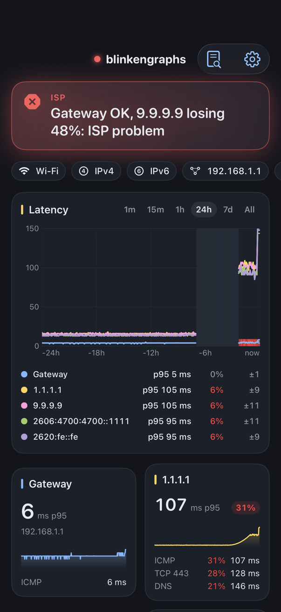
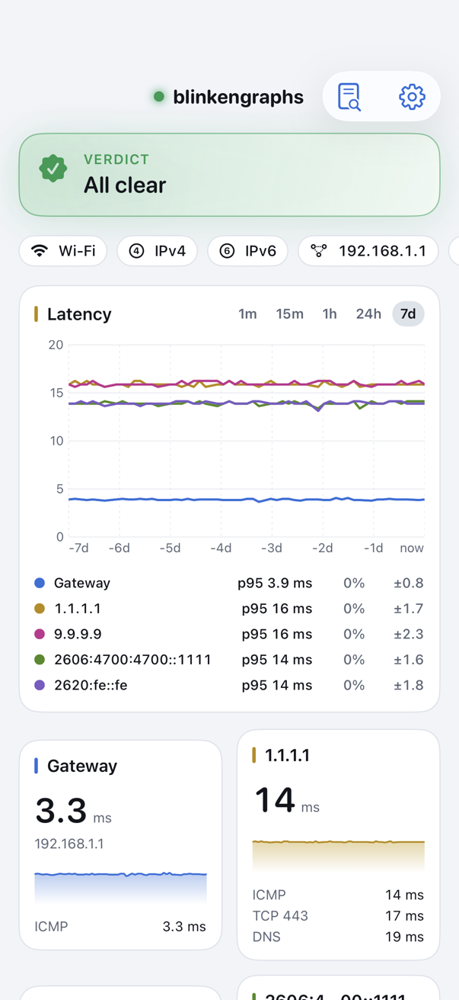

# blinkengraphs for iOS

A network diagnosis tool for iPhone and iPad. It shows live latency, DNS, path state and a hop trace, and gives a plain-language Verdict on where the network is failing: your Wi-Fi, your ISP, DNS, a VPN, a sign-in page or the far end.

<p>
  
  
  
</p>

**Status:** 1.0. It builds from source and sideloads onto your own device; not on the App Store yet ([ADR 0003](docs/adr/0003-sideload-first.md)). It is the iOS member of the [blinkengraphs](https://github.com/reconbot/blinkengraphs) family; the [Windows version](https://github.com/reconbot/blinkengraphs-win) also ships.

## What it shows

- **Verdict:** names the fault, following the spec's rules: LAN or Wi-Fi, ISP, IPv4 or IPv6 broken, DNS, a remote host, ping filtering, a VPN or its exit, a captive portal, or no network at all.
- **Latency:** a gping-style chart with one line per Target (Gateway, Cloudflare, Quad9, over IPv4 and IPv6) and a loss strip. Ranges are 1m, 15m, 1h, 24h and 7d, and each point shows p95 by default.
- **Targets:** ICMP, TCP 443 and DNS per Target, including your own DNS server, with sparklines.
- **Hop Trace:** mtr-style, with router names and the silent tail collapsed.
- **Public Address:** your IPv4 and IPv6 as the internet sees them, from a DNS and an HTTPS lookup, flagged when the two disagree.
- **Reports:** copy or share a plain-text report, optionally redacted, for bug reports.
- **Light and dark**, following the system or chosen in Settings.

| | | |
|---|---|---|
| <br>All clear | <br>5G, IPv6-only | <br>Through a VPN |
| <br>Captive portal | <br>Offline | <br>7 days |

Screenshots are rendered by CI from demo data on every change to `main`.

## Scope

- Measures only while the app is open: no widget, no Live Activity ([ADR 0004](docs/adr/0004-foreground-only.md)).
- History is kept per network, in memory for 15 minutes and on the device for 7 days ([ADR 0005](docs/adr/0005-history-per-link.md), [ADR 0007](docs/adr/0007-rollups-as-daily-json-lines.md)).
- No system-wide CPU or memory: iOS doesn't expose them to apps.

## Spec

The vocabulary, Verdict rules, test vectors and design tokens live in [reconbot/blinkengraphs](https://github.com/reconbot/blinkengraphs). This app implements them natively, and its CI runs the spec's test vectors.

## Repositories

| Repo | Contents |
|---|---|
| [blinkengraphs](https://github.com/reconbot/blinkengraphs) | Landing page and shared spec |
| [blinkengraphs-win](https://github.com/reconbot/blinkengraphs-win) | Windows 11 app (Rust) |
| [blinkengraphs-mac](https://github.com/reconbot/blinkengraphs-mac) | macOS menu bar app (planned) |
| [blinkengraphs-ios](https://github.com/reconbot/blinkengraphs-ios) | iOS network diagnosis app |

## Building

Needs Xcode 16 or later and [XcodeGen](https://github.com/yonaskolb/XcodeGen).

```bash
git clone --recurse-submodules https://github.com/reconbot/blinkengraphs-ios
cd blinkengraphs-ios
cp Config/Local.xcconfig.example Config/Local.xcconfig   # set your team and bundle ID prefix
xcodegen generate
open Blinkengraphs.xcodeproj
```

The rules engine is a plain Swift package and runs the spec's vectors anywhere Swift runs, Linux included:

```bash
swift test --package-path BlinkengraphsKit
```

| Path | Contents |
|---|---|
| `spec/` | The spec, pinned to a release tag as a git submodule |
| `defaults.override.json` | This platform's overrides of the spec's shared defaults |
| `BlinkengraphsKit/` | `BlinkengraphsCore`: Probe stats, Hop Trace, Verdict, Graph aggregate, Rollups, Public Address, Measurements, Defaults. Foundation only |
| `App/` | The SwiftUI app: probing and UI |
| `project.yml` | XcodeGen project spec; the `.xcodeproj` is generated |
| `docs/adr/` | Decisions |
